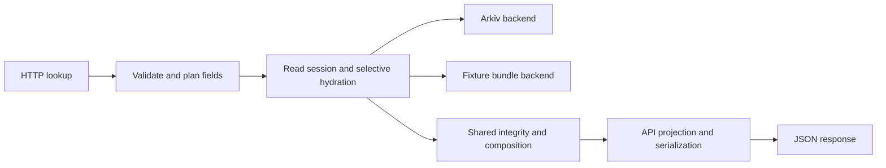

# Processor and read server architecture plan

Status: proposed design; no server implemented by this document. The
[requirements synthesis](sourcify-requirements.md) records source evidence,
provisional scope, and unresolved acceptance decisions.

## Recommendation

Add a dedicated **`arkiv-sourcify-server` workspace crate and executable**. Keep the
existing root `arkiv-entity-processor` package, library, and CLI. Share entity
validation and hydration code; keep HTTP, async transport, and API response policy
in the server crate. A second binary inside the root package would be simpler
initially, but would mix service dependencies and release concerns into the offline
tool. A standalone repository would unnecessarily duplicate the storage contract.

Do not start with a wholesale move into a third core crate. Extract one later if
shared dependency weight or reuse justifies it. This first split may still compile
root-package dependencies used only by processor commands; slimming them is a
separate, measured refactor.

## Inspected implementation baseline

Design evidence comes from processor commit
[`27098f5`](https://github.com/Arkiv-Network/sorcify-arkiv-entity-processor/tree/27098f5647e6c3f398569e20dda3cdd895c0387c)
on `feat/lossless-shared-entities`. This documentation branch is based on an older
`main`; implementation must first integrate or explicitly depend on the v3 reader
changes. Do not assume every reader described here is already on `main`.

- `Cargo.toml` already defines a library package and CLI binary.
- `src/hydrate.rs` exposes synchronous `hydrate_with(contract, resolver)` with
  integrity checks. It currently expands an entire compilation before selecting
  a referenced field.
- `src/hydrate_cli.rs` decodes bundle wire entries, verifies identities, and builds
  an in-memory locator index. It does not have a chain/address lookup index.
- `src/split.rs` stores shared fields in compilation envelopes, which can spill
  into blob parts. Fetching ABI can therefore still require those parts.
- `src/lib.rs` canonicalizes input JSON. Existing semantic roundtrip tests do not
  prove original HTTP byte ordering can be reconstructed.
- The Rust processor has no HTTP router or Arkiv read backend. The older Next.js
  PoC reader uses a different storage model and is only a behavioral reference.

## Proposed layout

```text
Cargo.toml                         existing package plus workspace members
src/lib.rs                         entity model and transformation
src/hydrate.rs                     shared integrity and composition rules
src/reader/                        pure selection/dependency planning
src/bundle.rs                      reusable bundle decoding and locator store
src/hydrate_cli.rs                 existing CLI using the shared bundle reader
crates/server/
  Cargo.toml                       path dependency on the root library
  src/main.rs                      configuration and process lifecycle
  src/lib.rs                       application/router construction for tests
  src/api.rs                       HTTP validation and error mapping
  src/fields.rs                    versioned Sourcify field contract
  src/projection.rs                serving policy, including signature policy
  src/reader.rs                    bounded asynchronous dependency traversal
  src/backend.rs                   read-session interface and typed errors
  src/backends/arkiv.rs             Arkiv query and wire adapter
  src/backends/bundle.rs            fixture/development adapter
  src/dataset.rs                   manifest identity and readiness checks
```

Use an async HTTP/runtime stack such as Axum and Tokio in the server crate; select
versions compatible with the repository's pinned Rust toolchain at implementation
time. Keep the root hydration model independent of that runtime. Existing
`process`, `verify`, `hydrate`, `pack`, and `upload` commands keep their interfaces.



## Reader and transport contracts

Model a read session with dataset identity and a single backend state height.
Conceptual operations are `find_contract(chain, address)`, `resolve(kind, hash,
part)`, and optional key lookup within that session. These are internal interfaces,
not claims that equivalent named RPC endpoints exist.

The shared layer validates envelopes, discovers required references, and composes
values from supplied entities. The server drives that dependency plan asynchronously
with bounded concurrency. The offline CLI drives the same rules synchronously.
Never block an async worker on network calls inside today's synchronous resolver.

Keep typed failures for initial absence, ambiguous match, missing dependency,
corruption, unsupported schema, backend unavailability, pruned state, and resource
limits. Only initial absence maps to a contract `404`. An incomplete import should
fail readiness rather than make incomplete coverage look like legitimate misses.

### Selective hydration

1. Validate field selectors and calculate required base fields before backend work.
2. Find the contract using normalized address, Ethereum chain ID, and dataset scope.
3. Decode and validate the verification envelope, then follow only selected paths.
4. Select compilation paths before expanding their child references. Include any
   dependencies required by local references and nested selectors.
5. Deduplicate reads within the request. Verify complete logical payloads before
   using selected values; a spilled compilation still needs complete reassembly.
6. Apply the explicit serving projection, then serialize according to the field
   comparison contract. Do not rewrite stored data to hide source differences.

For ABI/compilation, the desired property is **no unrelated source/code dependency
fetches**, not “zero blob reads.” Retain full hydration as a reference oracle. A
future storage split for small frequently requested fields needs benchmark evidence
and a versioned migration; it is not required for the first service skeleton.

### Arkiv adapter

Backend evidence is the experimental node at
[`aaf58ab`](https://github.com/Arkiv-Network/arkiv-state-db-experiment/tree/aaf58ab210d61959fce5e3ea66fd32e9e05412cd),
particularly `crates/arkiv-node/src/signed/rpc_reads.rs`,
`docs/node-api-reference.md`, and `docs/sdk-compatibility.md`. This is not evidence
that the intended Sorbet deployment runs the same protocol.

The inspected experimental stack implements `arkiv_query` with `atBlock`, `select`,
`limit`, and `cursor`. Entity-key reads can use a query on `$key`; do not invent an
`arkiv_getEntity` method. Confirm these capabilities against the chosen deployment.
Ordinary JSON-RPC reads are not proof-verified, even when forwarded by a light node.
Hash validation of returned content does not prove dataset completeness or a miss.

Bundle payloads use base64 and typed strings; RPC payloads use hex and attribute
arrays, including hexadecimal integer values. Normalize each transport into the
same validated entity representation. Restore staging identity and remapped
reference attributes explicitly; validate them with an imported real fixture.

Queries must constrain entity kind, chain/address or content hash, trusted owner,
and the selected import. An owner alone does not distinguish successive imports:
use a dedicated dataset owner/network or introduce an indexed dataset identifier
before loading. Define uniqueness at import time; detect ambiguous lookup results
rather than relying on unspecified order or choosing the first match. Detect
duplicates even across pages and preserve scope on every dependency query.

The experimental node has cursors and count support, but lacks arbitrary attribute
ordering/offset semantics. These capabilities do not put listing or counts in the
server MVP. Its current RPC implementation also projects response fields after an
internal full projection: `select` can reduce network output without guaranteeing
reduced database payload I/O.

Account for its query limit of 200 entities, response cap of 8 MiB, and hex payload
expansion when choosing page/batch sizes. Cursors are process-bound and may disappear
on restart or eviction; recover within the same read session or fail the request.
Keep the indexed lookup a supported equality conjunction: more complex Boolean
queries can fall back to a bounded scan and must not be assumed to prove absence.
Detect budget/truncation errors rather than converting incomplete results to `404`.

### Dataset identity and read consistency

Distinguish Ethereum chain ID `1` from the Arkiv network identity. Configuration
binds the backend network/genesis, trusted owner/import identity, schema version,
manifest digest, source cutoff, counts, and load timestamps. Validate the configured
network and dataset before becoming ready; no writer key belongs in the server.

Recommended current-state behavior: acquire one retained head height for each
request and use that `atBlock` for all lookups and dependencies. The dataset remains
the one-off import, but explicit deletions affect subsequent requests. Identify the
block hash/root separately because the inspected `atBlock` selector is a height,
not a hash. Verify the view remains consistent and handle reorgs or pruned history
as errors, never by silently switching to latest midway through hydration.
The experimental node's `safe`/`finalized` tags represent its accepted local head,
not an independently established consensus-finality guarantee.

Do not pin forever to the original load height: historical reads could continue to
serve data after deletion. If a permanently pinned view is desired, it needs a
different retention and takedown agreement. Internal per-request pinning is not a
public historical-query feature. Required history retention must cover an in-flight
read, or the whole request fails/restarts under a bounded retry policy.

### Caching and limits

Start with request-local deduplication. Cross-request positive/negative caches must
include network, dataset, schema, read height/block identity, and projection policy.
Do not reuse stale negative results during an import or stale positives after
deletion. Reusing immutable content bytes across heights still requires current-view
reference/existence validation; defer that optimization until deletion tests pass.

Bound request concurrency, backend concurrency, deadlines, retries, response bytes,
decoded bytes, reference count/depth, and gzip expansion. Stop fetching on cancelled
requests. Size limits against measured largest records; acceptance requires the
agreed dataset's supported responses to fit, not silently truncating large contracts.

The bundle backend needs an address index and safe concurrent positional reads or
separate handles. Its full scan and in-memory indexes are acceptable for fixtures;
Mainnet bundle serving needs separate startup/RAM measurements and is not the
production default.

## HTTP contract and operations

Implement `GET /v2/contract/{chainId}/{address}` for Mainnet only. Specify minimal,
selected, and all-supported fields in a versioned fixture-backed matrix. Resolve
`omit`, nested selectors, duplicate parameters, and error-body compatibility before
claiming endpoint parity. Keep snapshot metadata and health/readiness under an
operational namespace outside the Sourcify response body.

Proposed status families: `400` for invalid requests/unsupported chains, `404` for
initial absence, `502` for corrupt or incompatible upstream data, `503` for backend
unavailability/unready dataset, and `504` for deadlines. Final error bodies and
overload behavior belong in the API specification. No successful partial body on
missing dependencies and no fallback to live Sourcify.

Expose low-cardinality metrics for field group, response status, latency, backend
reads/bytes, hydration work, cache hits, and failures. Keep raw addresses out of
metric labels. Run a separate server image/process with graceful shutdown and a
read-only configuration. Keep processor deployment and release artifacts intact.

## Delivery plan and exit checks

| Phase | Change | Exit check |
| --- | --- | --- |
| 0. Contract | Reconcile dataset/signature/proxy decisions; enumerate fields and errors; pin upstream response fixtures and backend protocol | One explicit compatibility matrix and manifest contract; unresolved exceptions visibly recorded |
| 1. Shared reader | Integrate v3 baseline, add workspace/server skeleton, extract bundle decoding and pure hydration planning | Existing CLI tests and deterministic bundle checks unchanged; all workspace targets build |
| 2. Selective fixture server | Add field-aware async traversal, bundle adapter, lookup route, typed errors, health/readiness | Independent HTTP fixtures pass; counting backend proves cheap misses and selective reads |
| 3. Arkiv serving | Add wire normalization, dataset scope, consistent sessions, limits and deletion-aware caches | Process/import/read a real fixture through the target node; fault and state-transition tests pass |
| 4. Parity and sizing | Resolve signatures/proxy policy; run conformance and representative cold/warm benchmarks | Published field-level results, latency/throughput/error/cost measurements and capacity envelope |
| 5. Release | Dedicated image, runbook, public URL/docs, monitoring and licensing checks | Reproducible deployment and acceptance suite against the actual Arkiv backend |

Phases 1–2 can proceed after the reader/backend interface is agreed; the disputed
signature/proxy policies remain isolated. Do not declare complete API parity or
milestone completion before phases 0, 3, and 4 resolve those decisions.

## Required verification

- Existing processor roundtrips, deterministic output, and Bun/Parquet pipeline tests.
- Selective hydration equals projection of full hydration, including local pointers,
  escaped source paths, nulls, arrays, shared data, chunks, and unknown stored fields.
- A fixture miss performs one lookup operation and no dependency work; selected
  ABI/compilation requests never fetch unrelated source/code entities.
- Golden HTTP cases come from pinned independent references, including malformed
  requests and selector edge cases. Test signature derivation independently from
  preservation and reproduce known mismatch cases when the source cases are available.
- Missing/corrupt dependencies, duplicate contracts, wrong owners/networks, partial
  imports, incompatible wire formats, outages, and pruned state cannot become `200`
  or a false `404`.
- Concurrency/cancellation tests verify bounded work and no mixed-height responses.
  Delete a previously cached record and verify the next current-state request does
  not serve it; include dependency deletion and dataset switches.
- Real-node integration covers process → import → query → hydration. Byte-comparison
  tests are separate from value-comparison tests; canonicalized input may require
  additional ordering information before byte identity is achievable.

Update CI and release builds to select workspace targets explicitly, for example
`cargo test --workspace --locked` and workspace Clippy/build checks. Retain the
existing processor smoke tests and container pipeline; add server-specific checks
without replacing them. Run the relevant suite at each implementation phase.
